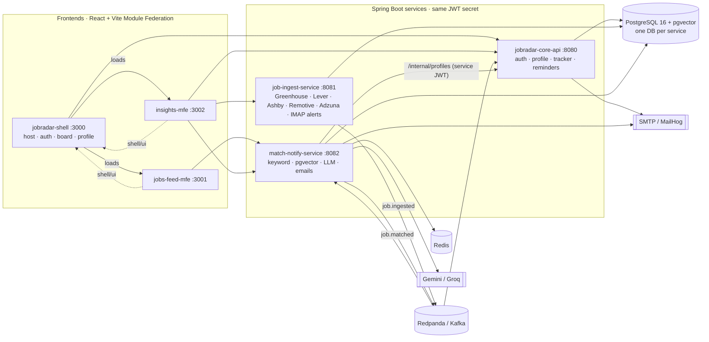

# jobradar-core-api

Core backend of **JobRadar**, an automated job finder: it ingests jobs from public job boards and LinkedIn/Naukri alert emails, scores them against your profile (keywords → embeddings → LLM), emails strong matches, and tracks applications on a kanban board.

This service owns **auth, profile/resume, the kanban tracker and follow-up reminders**, plus the local infrastructure (`infra/`).

## Architecture



## API

| Endpoint | Purpose |
|---|---|
| `POST /auth/register` `/login` `/refresh` `/logout`, `GET /auth/me` | JWT auth: 15-min access token, 7-day refresh token rotated on every use, reuse detection revokes the whole family |
| `GET/PUT /profile` | Skills, experience, CTC, work mode, target roles, locations, blacklist, alert threshold, quiet hours |
| `POST /profile/resume` | PDF upload → text (PDFBox) → skill extraction merged into the profile |
| `GET/POST /applications`, `PATCH /applications/{id}`, `PATCH /applications/{id}/move`, `DELETE` | Kanban: Suggested → Saved → Applied → Interview → Offer / Rejected; stage history in `application_events` |
| `GET /stats/funnel` | Funnel for insights-mfe |
| `GET /internal/profiles` | Service-to-service (role SERVICE) |

Kafka: consumes `job.matched` → creates *Suggested* cards, moves them on Save, removes them on Ignore. A daily job emails follow-up reminders.

Swagger UI: http://localhost:8080/swagger-ui.html

## Run locally

Prerequisites: Java 21, Maven, Node 22, Docker Desktop. Clone the six repos side by side, then in this repo create `.env` with a 32+ character `JWT_SECRET` (copy the same file to job-ingest-service and match-notify-service).

```powershell
.\infra\run-local.ps1      # infra + 3 backends + 3 frontends → http://localhost:3000
```

Or just infra: `docker compose -f infra/docker-compose.yml up -d` (add `--profile messaging` for Redpanda + MailHog) and `mvn spring-boot:run`.

Tech: Java 21, Spring Boot 3.5, Spring Security, jjwt, JPA/Flyway, Spring Kafka, Spring Mail, PDFBox, Springdoc.
